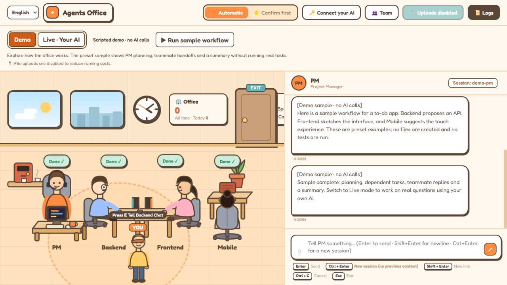

# Agents Office 🏢

A multi-agent software engineering orchestrator with a visual office. A PM agent breaks a feature request into ordered tasks and hands them to Claude and OpenAI (GPT / Codex) teammates that work in parallel.

**[Live demo](https://catfly.dev/agent-office/)** · [Case study](https://catfly.dev/projects/agents-office/)



## How it works

1. **Plan.** The PM agent turns your request into up to three tasks, one per teammate. A task can wait for another task.
2. **Run.** Tasks that do not depend on each other run in parallel. Each one runs the official Claude Code or Codex CLI in a fresh session.
3. **Edit files.** Teammates read and edit files in a folder you choose, through a per-request MCP server. Each teammate has its own access, which can be read-only. The server keeps no copy of your project.
4. **Summarize.** The PM reports what was done and what is left.

## Results

Starting each task in a fresh session with a short handoff, instead of passing the full conversation history, cut token usage by 86%, from 5.3M to 0.73M tokens.

## Two modes

| Mode | What happens | AI usage |
| --- | --- | --- |
| **Demo** (default) | A scripted clothing-shop project plays from start to finish. | None |
| **Live** | You sign in with your own Claude or ChatGPT account and give the team real work. | Your own account |

Chats, settings and sign-in tokens are stored in your browser, not on the server.

## Run locally

Install Node.js 24, then:

```sh
git clone https://github.com/catflyx520/agents-office.git
cd agents-office
npm install
npm start
```

Open **http://localhost:3000**. The Demo needs no account and no `.env`.

## Development

```sh
npm run check
npm test -- --runInBand
```

**Stack:** native JavaScript / DOM / SVG · Node.js 24 · Express · WebSocket · MCP · Docker · AWS EC2 · CloudFront

More detail: [technical notes](docs/TECHNICAL-NOTES.md) · [AWS deployment](docs/AWS-DEPLOYMENT.md)

## License

[MIT](LICENSE)
