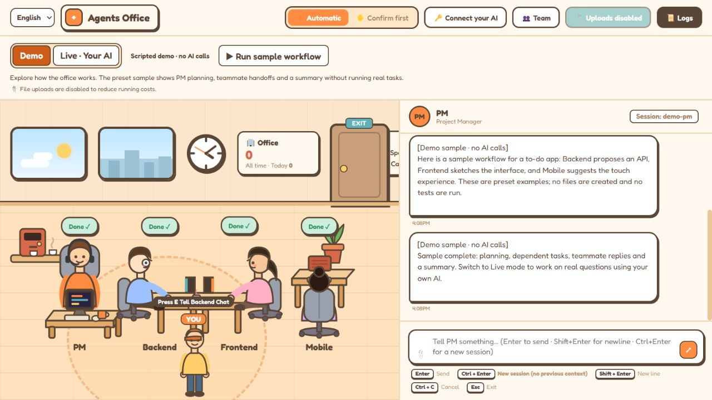

# Agents Office 🏢

A visual office for AI teamwork. Explore a scripted Demo, or connect your own OpenAI / Claude API for real conversations, task planning, teammate handoffs and code suggestions.

像素风 AI 办公室：默认先体验 Demo；正式模式使用访客自己的 AI API。为减少运行成本，两个模式均禁用文件上传。



## Two modes

| Mode | Behavior | AI usage |
| --- | --- | --- |
| **Demo — default** | Preset to-do app workflow showing PM planning, dependent tasks, teammate replies and a summary. Every sample is labeled. | No provider calls or model tokens. |
| **Live — your AI** | Visitor supplies an OpenAI or Anthropic API key and editable model ID. Replies stream from the chosen provider; PM can delegate up to three teammate tasks and summarize their proposals. | Uses that visitor's API account. A team workflow can make multiple requests. |

The web version provides chat, plans and code suggestions. It does not execute shell commands, inspect project directories, run tests or change repository files. Upload controls are disabled, and `/upload` rejects requests before reading their bodies. The original local CLI runner remains available separately.

**Live Demo:** [Agents Office](https://d396om3j4lmtlb.cloudfront.net). The password-free release was [deployed and verified](https://github.com/catflyx520/agents-office/actions/runs/39339228277) on October 19, 2026 (America/Los_Angeles). It opens in Demo; visitors can switch to Live mode to connect their AI. See the [deployment guide](docs/AWS-DEPLOYMENT.md) for operation and checks.

## Run locally

Install Node.js 24, then:

```sh
git clone https://github.com/catflyx520/agents-office.git
cd agents-office
npm install
npm start
```

Open **http://localhost:3000**. Demo needs no account, `.env`, API key or CLI installation. Select **Live · Your AI** to enter a provider, model ID and your API key. Saving the key makes no model request; it is marked verified only after a successful reply. **中文 / English** changes the interface language.

`npm ci` is also available for a clean installation of the exact dependency versions in the lockfile.

## Visitor data

- Each WebSocket connection owns its key, agents, conversation context, pending plans and provider-reported usage. Replies are never broadcast to other visitors.
- Keys pass through this server to the selected provider over HTTPS. They are held only in memory, not written to files, logs, `.env`, localStorage or sessionStorage. The form clears its key field after submission.
- Disconnecting, refreshing, returning to Demo or 15 minutes without client activity clears the server session and aborts active calls. Reconnect your AI to continue. Chat is not persisted by the public app.
- The public runtime never reads the owner's model credentials, CLI logins, projects or saved local sessions. Provider URLs are fixed to official OpenAI / Anthropic endpoints.
- Requests have context/output limits, timeouts and a bounded number of concurrent provider calls. Token counts come from provider responses, not estimated dollar charges. Demo does not fabricate usage.

## Local CLI version

For the original single-user coding workspace, install your chosen Claude Code / Codex CLI and use:

```sh
npm run start:local
```

CLI login or the ignored `.env` configures this local version. See [Setup](docs/SETUP.md). It can modify local files and run commands with permissive agent execution settings; keep it on a trusted computer and do not publish that single-user server as the public app. Uploads remain disabled.

## Development and AWS

```sh
npm run check
npm test -- --runInBand
npm run prepare:hosting
```

The ARM64 CI check builds the public Docker image and verifies the real Nginx/WebSocket path, Demo workflow, upload rejection and visitor connection state without making paid AI calls. API streaming tests use isolated provider fixtures; a real paid key has not been used for acceptance.

**Stack:** native JavaScript / DOM / SVG · Node.js 24 · Express · WebSocket · EC2 Docker · CloudFront. No frontend compilation step is required.

Source: `client/`, `server/`, `tests/`, `deployment/`. [AWS deployment and rollout](docs/AWS-DEPLOYMENT.md) includes the existing account resources, console step, rollback and costs.

## License

MIT
